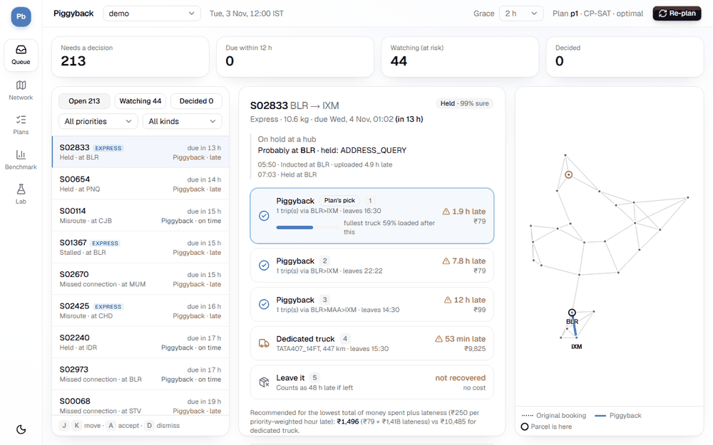
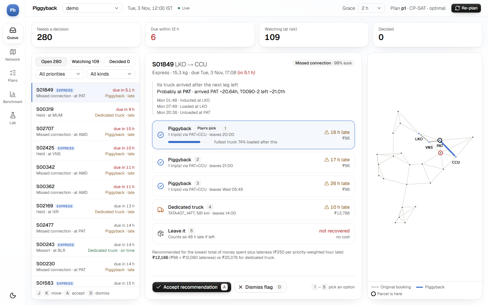
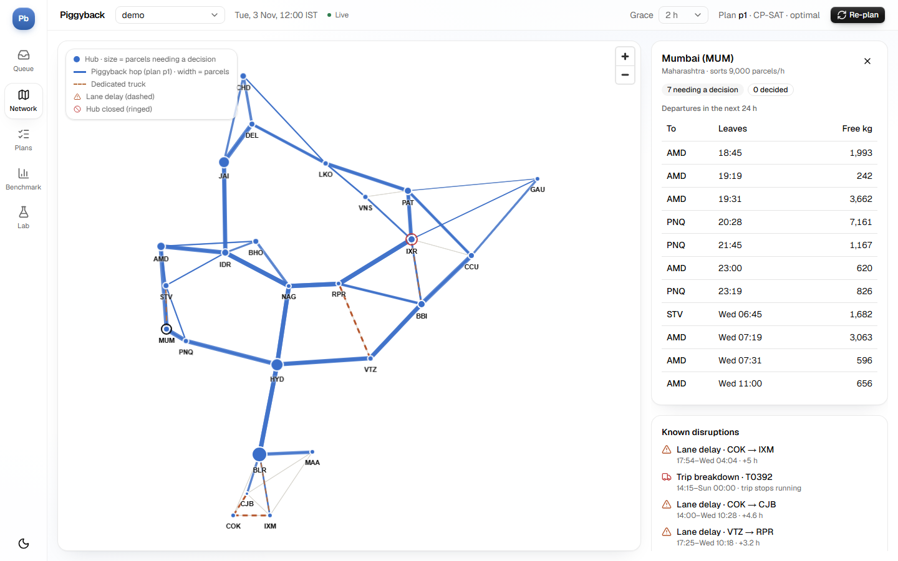
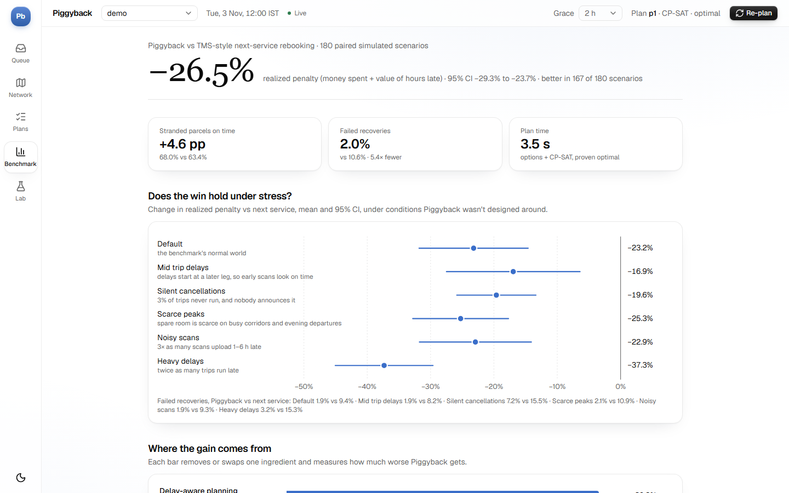
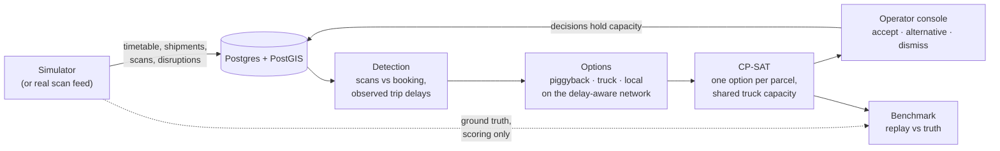

# Piggyback

[](https://github.com/Sathvik103/piggyback/actions/workflows/ci.yml)

**Delay-aware recovery of stranded shipments onto trips that are already scheduled and have spare room.**

When a parcel gets stuck in a line-haul network (held, mis-sorted, misrouted, or stranded by a late truck), carriers typically rebook it onto the next scheduled service, or send a dedicated truck. Piggyback works differently:
- it detects stranded parcels from scan histories,
- it plans their recovery across all of them at once with a CP-SAT optimizer, on trucks that are already running with spare room,
- it plans on how late trucks are actually running, not on the published timetable,
- and it hands an operator a queue of explainable recommendations to accept, change or dismiss.

**Result.** Over 180 paired simulated scenarios against TMS-style next-service rebooking:
- **−26.5% realized penalty** (money spent plus value of hours late; 95% CI −23.7% to −29.3%), better in 167 of 180
- **+4.6 pp** stranded parcels on time
- **failed recoveries 2.0% vs 10.6%**

The win holds in all six stress conditions it wasn't designed around (−17% to −37%), and up to 40,000 shipments plans come within 1.4% of the proven optimum. Road distances and drive times between hubs are real (OpenStreetMap via OSRM). [Full results](results/REPORT.md) · [robustness](results/ROBUSTNESS.md) · [scaling](results/SCALING.md) · [how it's measured](#benchmark-piggyback-vs-what-carriers-do-today)





<table><tr>
<td></td>
<td></td>
</tr></table>

## How it works



| Layer | What it is |
|---|---|
| `simulator/` | Seeded India line-haul world: 25 hubs, timetable, 3,000 shipments, scan histories cut at "now", strandings, disruptions, trip delays, upload lag, plus stress conditions. Ground truth kept apart. |
| `detection/` | Rule-based, explainable detector reading only what an operator can see. Precision 0.92 / recall 0.96 over 30 seeds. |
| `recovery/` | Delay- and disruption-aware planning network, recovery options, CP-SAT optimizer with greedy and do-nothing baselines, replay against the truth. |
| `benchmark/` | Head-to-head vs carrier-style policies, plus ablations, paired 95% CIs, a sensitivity analysis and stress tests. |
| `db/`, `api/` | Postgres as system of record (migrations, append-only decisions, capacity holds that can't be overbooked), FastAPI. |
| `web/` | React + TypeScript operator console (Vite, Tailwind, shadcn/ui, TanStack Query, MapLibre). |

**Status:** all 7 planned steps are built, with CI (lint, tests against PostGIS, Playwright end-to-end and axe accessibility tests, benchmark smoke run) and Docker. See [`docs/DECISIONS.md`](docs/DECISIONS.md) for the design decisions and their trade-offs.

## Quick start

```bash
pip install -r requirements.txt
python -m pytest                                           # all tests (DB tests skip if Postgres is down)
ruff check .                                               # lint
python -m simulator.cli --seed 42 --out data/scenario_42   # CSVs + scenario.json + summary.json
python -m detection.cli data/scenario_42                   # detections.csv + score vs truth
python -m detection.cli data/scenario_42 --sweep           # precision/recall across grace periods
python -m recovery.cli data/scenario_42                    # plan_*.csv per solver + replayed KPIs
python scripts/eval_detection.py 30                        # detection over seeds 1-30
python -m benchmark.run                                    # head-to-head benchmark, 180 scenarios (~3 min) -> results/
python -m benchmark.run --stress                           # same contest under harder conditions -> results/ROBUSTNESS.md
(cd web && npm ci && npm run build)                        # build the web app into api/static
(cd web && npm run e2e)                                    # Playwright end-to-end tests against the running API
(cd web && npm run screenshots)                            # re-capture the README screenshots into docs/img
(cd web && npm run demo) && python scripts/make_demo_gif.py # re-record docs/img/demo.gif
python -m benchmark.scaling                                # plan time and optimality from 3k to 40k shipments
python -m uvicorn api.app:create_app --factory --port 8000 # web app at http://localhost:8000/, API docs at /docs
```

Database (needs Docker running; the API needs it, the CLIs above don't):

```bash
docker compose up -d db                      # Postgres 16 + PostGIS on localhost:5433
docker compose --profile app up -d --build    # ...plus the API + web app container on :8000
python -m db migrate                         # apply db/migrations (the API also does this on start)
python -m db load data/scenario_42           # load a simulator.cli folder, or:
python -m db seed scenario_7 --seed 7        # generate straight into Postgres
```

On Windows, `scripts/start_docker.ps1` starts Docker Desktop and the database. It works around a Docker Desktop bug where leftover socket files make it crash on start. The database is published on port **5433**, so it doesn't clash with a locally installed Postgres on 5432. Set `DATABASE_URL` to point elsewhere; tests use a separate `piggyback_test` database (`PIGGYBACK_TEST_DATABASE_URL`) that they wipe and re-migrate.

## What the simulator builds

One call to `generate_scenario(seed=...)` returns a complete, replayable world (seed 42 numbers shown):

- **Network**: 25 Indian hub cities and 94 directed lanes (minimum spanning tree + 3 nearest neighbours by real road distance, so always connected).
- **Timetable**: 80 corridors, each repeating every 12 h or 24 h. That gives 647 trips and 1,264 legs over 144 h, so recovery can book departures well after "now". Every leg has sampled spare kg and m³.
- **Shipments**: 3,000 with priority-based deadlines, each booked on its earliest-arrival itinerary. The operator sees only scans that reached the system by "now" (hour 36).
- **Noise**: 20% of trips run 0.5–4 h late, and 5% of scans upload 1–6 h late. Healthy parcels therefore sometimes look lost.
- **Strandings**: individual `MISROUTE`, `LOST_SCAN` and `HELD` cases, plus burst `MISSORT` incidents where many shipments miss their next leg at one hub. There are also `MISSED_CONNECTION`s caused by late trips. Seed 42 has 261 stranded shipments.
- **Disruptions**: trip breakdowns, hub closures and lane delays, starting at or up to 8 h after "now".
- **Ground truth** is kept apart (`sim_truth` and `sim_trip_delays` tables, `Scenario.truth`) so detection and planning never see it. It exists only for scoring and replay.

Benchmark knobs: `capacity_tightness`, `anomaly_rate`, `n_incidents`, `n_disruptions`, `n_shipments`, `trip_delay_rate`, `scan_lag_rate`. Each is a CLI flag too, e.g. `--capacity-tightness 0.8`.

## Detection

`detection.detect(view)` sees only an `OperatorView`: the timetable, shipments, visible scans and disruptions, never the truth. For each undelivered shipment it compares the visible scans with the scans its booking should have produced. Expected times are shifted by how late each trip is observed to be running. It flags `HELD`, `MISROUTE`, `LOST_SCAN`, `MISSED_CONNECTION`, `STALLED` and `MISSORT` (a cluster of stalls at one hub). It also flags `AT_RISK` for parcels on a late truck that will miss their connection. Each detection includes the hub where the parcel probably is, how overdue it is, a confidence score and the evidence.

Over seeds 1–30 with default settings: precision 0.918, recall 0.965, F1 0.941. Type and hub are right for over 99% of correct flags. Most false positives are scans that uploaded late. `--grace` trades recall for precision.

## Recovery

1. **Options** (`recovery.generate_options`): for each detection, the parcel is assumed to be at the suspected hub, ready after a handling time that depends on what went wrong. It gets up to 3 **piggyback** itineraries on scheduled trips with enough spare kg and m³, a **dedicated** truck, **local** delivery if it is already at its destination, or **none**. The planner's timetable shifts trips by their observed delay, applies lane delays, drops legs after breakdowns, and blocks loading and unloading at closed hubs.
2. **Optimizer** (`recovery.solve_cpsat`): picks one option per shipment to minimize cost + ₹250 × priority weight (EXPRESS 3, STANDARD 2, ECONOMY 1) × hours late. Every leg must stay within its spare capacity. It uses OR-Tools CP-SAT and proves the optimum in well under a second at default tightness. The baselines are `solve_greedy` (most to lose goes first) and `solve_none`.
3. **Replay** (`recovery.replay`): runs a plan against the truth. A plan fails if the parcel isn't at the hub the plan starts from, or if a trip ran later than anyone had observed and a connection breaks.

## Benchmark: Piggyback vs what carriers do today

`python -m benchmark.run` runs 180 simulated scenarios: seeds 1–20 × capacity tightness 0.3/0.6/0.9 × anomaly rate 0.02/0.04/0.08. On each one it runs every recovery policy below, replays every plan against the ground truth, and writes [results/REPORT.md](results/REPORT.md) with paired comparisons and 95% confidence intervals. All policies get the same detections, so the comparison isolates *recovery*.

**Baselines:**
- **Next service, FCFS:** a typical TMS auto-rebook. It books the earliest service with room on the published timetable, in the order problems appear.
- **Next service + truck for late EXPRESS:** the same, plus a control-tower rule of thumb.
- **Do nothing.**

Both next-service baselines are reactive, but they still rebook a parcel when it strands later.

**Results**, Piggyback minus baseline on the same scenarios (± is a 95% confidence interval):

| Piggyback vs | Δ stranded on time | Δ realized penalty¹ | Failed recoveries | Lower penalty in |
|---|---|---|---|---|
| Next service, FCFS | **+4.6 pp** (±0.8) | **−26.5%** (±2.8) | **2.0% vs 10.6%** | 167 / 180 |
| Next service + truck for late EXPRESS | −4.4 pp (±0.9) | **−45.1%** (±1.9) | 2.0% vs 9.6% | 180 / 180 |
| Do nothing | +68.0 pp | −84% | — | 180 / 180 |

¹ Money spent + ₹250 × priority weight × hours late. Against next-service, the win holds whatever a late hour is worth, from ₹50 to ₹1000 (−9.9% to −30.3%). The truck rule gets more parcels on time by spending ₹8.2 lakh per scenario on trucks, about 8× Piggyback's spend.

**Where the gain comes from** (ablations, each changing one ingredient):
- **Delay-aware planning is most of it.** Planning on observed trip delays and known disruptions, instead of the published timetable, is worth −20.8% penalty and cuts failed recoveries from 9.3% to 2.0%.
- **The transfer buffer is a reliability feature.** Piggyback demands 1.5 h extra slack when transferring off a truck nobody has been scanned on yet. That more than halves failed recoveries (4.4% → 2.0%) for −0.6 pp on time. Its penalty saving here (−3.3% ± 2.1) did not reproduce on the validation seeds after the switch to real road times, so treat it as a reliability feature, not a cost saver. The buffer size was chosen on separate validation seeds (101–110), never on the reported ones.
- **The CP-SAT optimizer adds −3.0% overall.** That's about zero when trucks have room, and −8.0% when capacity is tight (0.9). It matters most at scale (see below).
- **Acting early on at-risk parcels doesn't pay.** Piggyback watches them and rebooks only once they really strand. Rebooking them early instead is no better (−0.7% ± 0.7 in favour of waiting, not significant) and ties up capacity on predictions.

**Disclosure:** Piggyback originally rebooked at-risk parcels proactively. The benchmark's own ablation showed that didn't pay, so the default was switched to wait-then-act and the benchmark re-run. The numbers above are for the shipped default. Proactive rebooking is still available as `include_at_risk` on the API and `--include-at-risk` on the CLI.

**Robustness.** `python -m benchmark.run --stress` re-runs the contest under conditions Piggyback was not designed around, each changing one thing from the default world. Full tables are in [results/ROBUSTNESS.md](results/ROBUSTNESS.md).

| Condition (10 seeds × tightness 0.6/0.9) | Δ penalty vs next service | Δ on time | Failed: Piggyback / next service | Wins |
|---|---|---|---|---|
| Default world | **−23.2%** (±8.6) | **+4.1 pp** | 1.9% / 9.4% | 19 / 20 |
| Delays start mid-trip (early scans look on time) | **−17.0%** (±10.5) | +1.7 pp | 1.9% / 8.2% | 16 / 20 |
| 3% of trips silently cancelled | **−19.6%** (±6.2) | **+5.3 pp** | 7.2% / 15.5% | 20 / 20 |
| Spare room scarce on busy corridors and evenings | **−25.3%** (±7.6) | **+6.3 pp** | 2.1% / 10.9% | 19 / 20 |
| 3× noisier scan uploads | **−22.9%** (±8.8) | **+4.2 pp** | 1.9% / 9.3% | 17 / 20 |
| Twice as many late trips | **−37.3%** (±7.7) | **+7.4 pp** | 3.2% / 15.3% | 20 / 20 |

- **The win holds in every condition.** Delays starting mid-trip are the hardest case for delay awareness, which is still worth −11.3% there. In that condition neither the transfer buffer nor the optimizer makes a significant difference, and the on-time gain is not significant.
- **Silent cancellations** nearly quadruple Piggyback's failures, since no planner can see them coming, but it still fails at less than half the baseline's rate.

**Scaling.** `python -m benchmark.scaling` grows the network from 3,000 to 40,000 shipments with nearly full trucks (3 seeds each; full table in [results/SCALING.md](results/SCALING.md)). Plan time is what an operator waits for after pressing re-plan.

| Shipments | Stranded parcels | Plan time | CP-SAT proved optimal | Worst gap to optimum | Greedy's extra cost |
|---|---|---|---|---|---|
| 3,000 | 230 | 2.9 s | 3 / 3 | 0% | +17.0% |
| 6,000 | 580 | 32 s | 0 / 3 | 0.8% | +47.3% |
| 10,000 | 849 | 24 s | 1 / 3 | 1.3% | +49.2% |
| 20,000 | 1,678 | 35 s | 0 / 3 | 1.1% | +53.0% |
| 40,000 | 3,388 | 38 s | 0 / 3 | 1.2% | +45.1% |

Detection and option generation stay under 6 s even at 40,000 shipments. From 6,000 up, CP-SAT usually uses its 30 s limit, but its lower bound proves the plan is within 1.4% of the best possible. Greedy, by contrast, falls 17–53% behind as contention grows. On real road distances more parcels strand per thousand shipments than under the old straight-line estimate, so these instances are harder than in the previous run. Warm-starting CP-SAT from the greedy plan was tried and dropped: it was neutral up to 20,000 and made plans 11.5% worse at 40,000. A greedy safety net replaces it, so CP-SAT never returns anything worse than greedy.

These are results on Piggyback's own simulator. The benchmark is built to be fair: baselines get a second chance at parcels that strand later, and every number is reproducible from its seed. It is not evidence from a real network.

## API

`api/` is a FastAPI app backed by Postgres, which is the system of record for scenarios, plans and operator decisions. Expensive derived data (the operator view, the planner's network, detections per grace period) is cached in memory per scenario. Interactive docs are at `/docs`.

| Route | What it returns |
|---|---|
| `GET /scenarios`, `POST /scenarios` | List scenarios, or generate one from a seed and the benchmark knobs |
| `GET /scenarios/{id}` | Scenario summary |
| `GET /scenarios/{id}/network` | Hubs and lanes as GeoJSON, for the map |
| `GET /scenarios/{id}/disruptions` | Known disruptions |
| `GET /scenarios/{id}/detections` | Flags, filterable by `kind`, `hub` and `priority`, with `grace_h`, paging and counts |
| `GET /scenarios/{id}/shipments/{sid}` | A shipment's booking, visible scans, detection and plan choices |
| `GET /scenarios/{id}/hubs/{hub}` | Parcels stuck at a hub, and departures with spare room in the next `window_h` |
| `POST /scenarios/{id}/plans` | Run detection → options → `cpsat` / `greedy` / `none` for stranded parcels (`include_at_risk` adds AT_RISK ones); returns a summary |
| `GET /scenarios/{id}/plans[/{plan_id}]` | Saved plans; one plan's choices, filterable by `mode` |
| `GET /scenarios/{id}/shipments/{sid}/options` | Live recovery options for a flagged shipment, against capacity still free |
| `POST /scenarios/{id}/decisions` | `ACCEPT` a plan's choice or a live option, `DISMISS` a false flag, or `REVOKE` the decision in force; 409 if the capacity is gone |
| `GET /scenarios/{id}/decisions` | Decisions in force |
| `GET /scenarios/{id}/events` | Server-sent events: `decision` and `plan` as each one commits, `resync` if any may have been missed |
| `GET /scenarios/{id}/evaluation/...` | Detection score, a plan's replay, and a replay of the committed decisions, all against ground truth |

**Decisions and capacity.**
- **Append-only log:** decisions are never edited, and the latest row per shipment is the one in force.
- **Holds:** an accepted recovery holds spare kg and m³ on the legs it rides. The hold is a database view derived from the decisions, so it can't drift out of sync with them.
- **Planning:** plans and live options use the capacity left after holds, and a new plan only covers shipments nobody has decided on.
- **No overbooking:** accepting locks the legs involved in leg-ID order, so two operators approving onto the same truck at the same moment can't overbook it or deadlock. A test races two threads to prove it.
- **Live updates:** database triggers announce every committed decision and plan with Postgres `NOTIFY`, whoever wrote it. Each API process `LISTEN`s on one connection and relays the events to browsers as server-sent events, so operators see each other's work within a moment, even across API processes. Events carry ids only and clients re-fetch. After a dropped connection, or a client too slow to keep up, clients are told to re-sync, because events sent meanwhile are lost.

Only the `/evaluation/` routes read ground truth. A test checks that no operator route returns a truth field.

## Web app

`web/` is a React 19 + TypeScript app built with Vite, Tailwind and shadcn/ui, using TanStack Query for data and MapLibre for maps. `npm run build` writes it to `api/static`, and the API serves it at `/app/` (`/` redirects there). For development, `npm run dev` in `web/` proxies API calls to `localhost:8000`.

- **Queue** (home): the operator's work list. Flagged parcels are sorted by how soon they're due, and can be filtered by priority and kind, and split into open, watching (at risk) and decided. The recovery card shows:
  - what happened, with the detector's evidence and recent scans
  - the plan's recommendation and the live alternatives, each with its arrival against the deadline, its cost, and how full the fullest truck gets after loading
  - a one-line reason for the recommendation: the lowest money spent plus lateness, compared with the fastest alternative

  Operators can **accept** it, **pick an alternative**, or **dismiss** a false alarm. If another accepted recovery took the space first, the API returns 409 and the card refreshes its options. A mini map shows the original booking (dotted) and the recovery (bold). Keyboard: J/K move, A accept, D dismiss, 1–9 pick an option.
- **Network:** the full lane map, with hubs sized by parcels needing a decision and the latest plan's piggyback hops (width = parcels). Dedicated trucks are dashed, lane delays and hub closures use the reserved status colours with icons, and clicking a hub lists its next 24 h of departures with free capacity.
- **Plans:** run CP-SAT, greedy or do-nothing, optionally including at-risk parcels. Browse saved plans and their choices, and read the full decision log. A dashed "lab only" panel replays a plan against the ground truth.
- **Benchmark:** the head-to-head results from `/benchmark`: the headline with its confidence interval, the stress plot, where the gain comes from, all policies, results by capacity tightness, and the method.
- **Lab:** the scenario list; generating new ones (including the stress conditions); and detection precision and recall against the truth.

A Live badge in the header shows the event stream's state. When another session decides or plans, the queue, map and plans refresh in place, and a short notice says what changed. Times show in IST, relative to each scenario's simulated "now". Light and dark themes are both supported. On phones the side rail becomes a bottom tab bar, panels stack, tapping a parcel or hub scrolls its detail into view, and the map legend folds away. Only the plan replay and detection scoring read ground truth, and both are opt-in and visibly marked as lab features. The map draws the lane network without third-party basemap tiles, so it works offline and avoids drawing contested borders.

## Layout

```
simulator/   models, hub data, generator, CSV/JSON export, CLI
detection/   operator view (no truth), detector, scoring, CLI
recovery/    planner's timetable, options, CP-SAT/greedy optimizer, replay vs truth, CLI
api/         FastAPI app and the scenario store behind it; serves the built web app from static/
web/         React + TypeScript web app (Vite, Tailwind, shadcn/ui, TanStack Query, MapLibre)
db/          migrations/, migration runner, repository, `python -m db` admin CLI
benchmark/   baseline + ablation policies, grid runner, report
results/     benchmark.csv + REPORT.md, stress.csv + ROBUSTNESS.md from the last full runs
scripts/     eval_detection.py, start_docker.ps1 (Windows Docker Desktop helper)
.github/     CI: lint, tests against a PostGIS service container, benchmark smoke run
tests/       simulator, migrations, Postgres repository (incl. a concurrency race), detection, recovery, API, benchmark
docs/        DECISIONS.md
```

## Known limitations

- The CLIs (`simulator.cli`, `detection.cli`, `recovery.cli`) still work on CSV folders so benchmarks run without a database. The API and web app need Postgres.
- Detections aren't stored: they're recomputed (and cached) from the scans, which is cheap and keeps them consistent with the detector's code.
- The API has no authentication, and it allows cross-origin requests only from localhost. It's meant for local use.
- The end-to-end tests cover each page's main path (accept, pick an alternative, dismiss, map layers, hub panel, benchmark, form validation) and fail on any browser console error. One test drives two browser sessions: a decision in one appears in the other without a reload. Every page is also checked with axe against WCAG 2.1 A/AA in light and dark themes (the WebGL map canvas is excluded; its hubs are keyboard-focusable buttons). A phone project (Pixel 7, touch) walks every page through the bottom tab bar, checks nothing scrolls sideways, runs axe again, and accepts a recovery by tap. They don't cover every edge case.
- There's no login: decisions are recorded as "operator". It's a local, single-user tool for now.
- The replay checks each parcel's own plan against the truth, but doesn't re-simulate the whole network afterwards. A recovered parcel doesn't change other parcels' outcomes.
- About 4% of hub pairs can't be completed before the timetable ends at hour 144 (long cross-country trips with several transfers). For those, recovery can only use a dedicated truck.
- Road distances and corridor drive times are real (OSRM over OpenStreetMap, committed in `simulator/data/road_matrix.json`), but truck speed is scaled to an assumed 45 km/h network average. Vehicle costs and the ₹250 value of a late hour are assumed figures. Spare capacity is sampled rather than derived from real loads. The calibration numbers in `docs/DECISIONS.md` describe these assumptions, not real-world carriers.

## Data credits

Road distances and drive times between hubs come from the [OSRM](https://project-osrm.org/) table service over [OpenStreetMap](https://www.openstreetmap.org/copyright) data, © OpenStreetMap contributors, available under the Open Database License.
